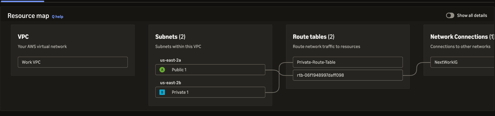
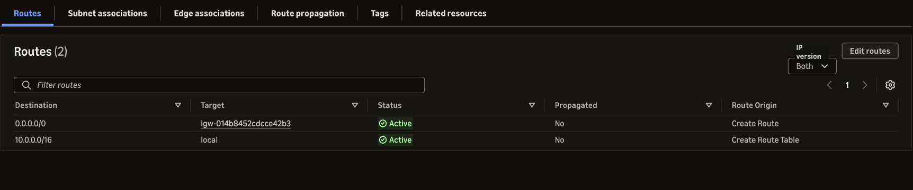
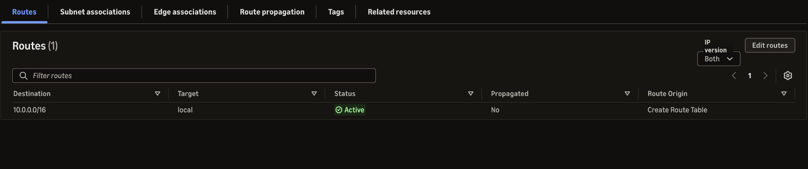
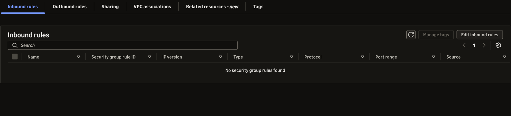
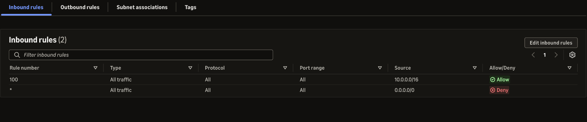
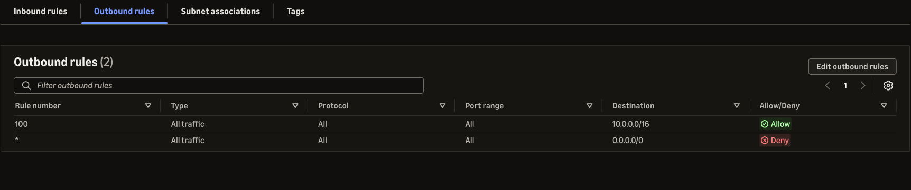
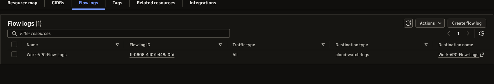

# AWS VPC Network Security Architecture

## Project Overview
Designed and configured an AWS Virtual Private Cloud (VPC) environment to demonstrate network segmentation, private subnet isolation, traffic filtering, and network monitoring.

The project focuses on foundational cloud network security controls using public and private subnets, route tables, security groups, network access control lists (NACLs), and VPC Flow Logs.

## Architecture
- AWS Region: us-east-2 (Ohio)
- VPC: Work VPC
- VPC CIDR: 10.0.0.0/16
- Public subnet and private subnet deployed in separate Availability Zones
- Internet Gateway attached to the VPC
- Separate route tables for public and private networking
- Security groups and NACLs configured for network access control
- VPC Flow Logs configured to deliver traffic metadata to Amazon CloudWatch Logs

## Security Implementation

### 1. Network Segmentation
Created public and private subnets within a custom VPC to separate network resources by intended exposure.

### 2. Route Table Configuration
Configured route tables for the network architecture. The private subnet route table contains a local route for internal VPC traffic, without a default route to an Internet Gateway.

### 3. Security Groups
Configured security group rules to restrict inbound access to private resources.

### 4. Network Access Control Lists
Configured a private subnet NACL with rules allowing traffic within the VPC CIDR (10.0.0.0/16) and denying other traffic. NACLs provide stateless subnet-level filtering.

### 5. Network Monitoring
Enabled VPC Flow Logs at the VPC level with delivery to CloudWatch Logs for visibility into network traffic metadata.

## Validation and Limitations
Verified the VPC configuration through AWS Console screenshots, including subnet architecture, routing, access control rules, and Flow Logs configuration.

No EC2 instances or network interfaces were deployed during validation. Therefore, end-to-end reachability and live traffic isolation were not demonstrated. VPC Flow Logs configuration was confirmed, but traffic records were not validated.

## AWS Services
- Amazon VPC
- Amazon EC2 Security Groups
- Network ACLs
- Internet Gateway
- Amazon CloudWatch Logs
- VPC Flow Logs

## Project Screenshots

### VPC Resource Map

### Public Route Table

### Private Route Table

### Private Security Group Inbound Rules

### Private NACL Inbound Rules

### Private NACL Outbound Rules

### VPC Flow Logs

## Key Takeaways
- Implemented AWS VPC network segmentation and routing controls
- Applied security groups and stateless NACL filtering
- Configured centralized VPC traffic metadata collection
- Documented architecture and configuration evidence for a cloud security portfolio

## Future Improvements
- Deploy test EC2 instances to validate network reachability
- Use VPC Reachability Analyzer to identify permitted and blocked network paths
- Generate and inspect VPC Flow Log records
- Implement automated infrastructure deployment with Terraform
